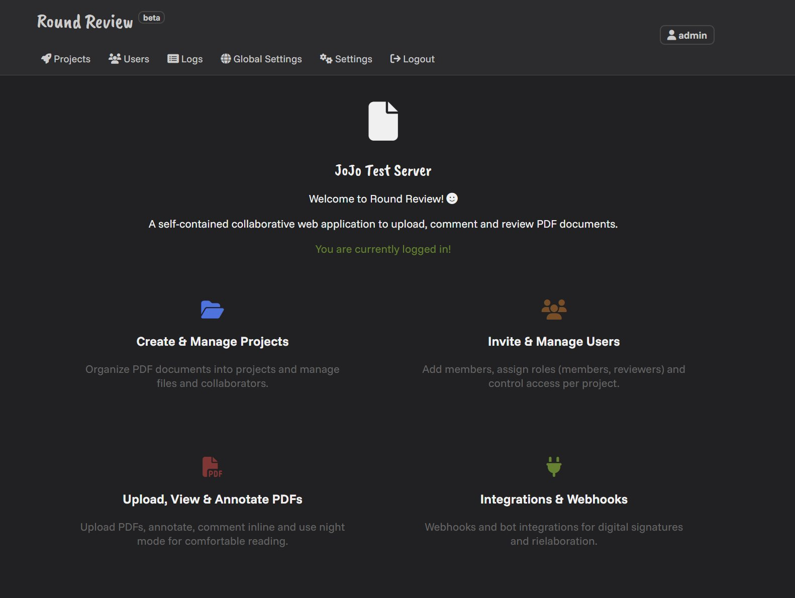
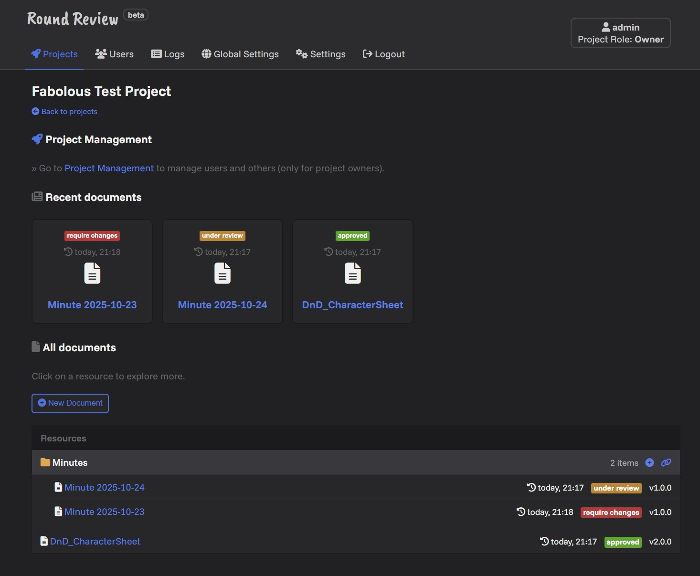
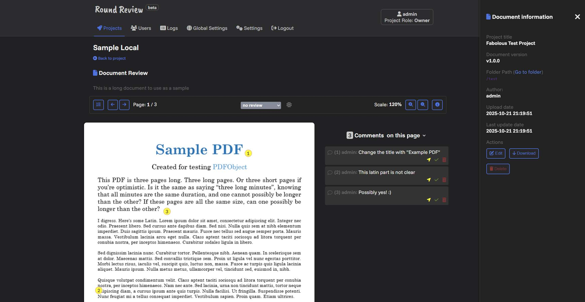

# <div align="center">📄 Round Review</div>

<div align="center">
Round Review is a PDF platform to manage documents and reviews with collaborators.<br><br>
</div>



Checkout more screenshots [here](https://github.com/Maxelweb/RoundReview/releases/tag/v0.2.0).

## Features

- 📁 **Create and manage projects** with PDF documents  
- 👥 **Invite and manage users** in each project  
- 📄 **Upload, view, and edit PDFs**  
  - Includes **night mode** for comfortable viewing



- 💬 **Click & comment on PDFs** for reviewers and project owners  



- 🎨 **Multi-theme support** (light/dark) 
- 🔐 **Basic and advanced user access**  
  - Includes **GitHub OAuth integration**  
- 🔔 **Webhook support** for notifications  
- 🔌 **API-based access** to all features  
  - 📚 Documentation is currently under development  
- 🐳 **Docker-based deployment** configurable via `.env`  
- 🛡️ **System admin panel** with audit logs  
- 🤖 **Plugins with Bot Integration Review**  
  - Supports external bots via 3rd-party API for document reviews  
    - 📝 *Example 1:* When a document is `Approved`, apply a signature to the PDF  
    - 🧠 *Example 2:* Integrate AI with LLM to create summaries and automatic reviews

> [!NOTE]
> The project is under active development and the current version is in **beta**

## 📄➕ Plugins

If you want to add **plugins** 📄➕ to your Round Review instance, checkout [Round Review Plugins](https://github.com/Maxelweb/RoundReviewPlugins).

## Installation and Maintenance

> [!IMPORTANT]
> Follow these instructions to get the container up and running properly

### Requirements


- A system with `linux/amd64` or `linux/arm64`.
- Docker with Docker Compose (v2+)

### First installation

1. Clone the repository in your system
    - `git clone https://github.com/Maxelweb/RoundReview.git`
1. Start Round Review using the published image
    - `docker compose up -d`
1. In the browser, go to [localhost:8080](http://localhost:8080)
    - If port `8080` is already in use, change the port mapping in `docker-compose.yml`.
    - To stop the app, use `docker compose down`.


To provide the full set of environment variables, copy `docker-compose.yml` to a custom Compose file, add an `env_file` entry pointing to `./envs/rr-app.env`, and follow the [environment variable documentation](./docs/envs.md). Create the environment file from the template with `cp envs/template.rr-app.env envs/rr-app.env`.

#### Default admin credentials

The following credentials apply if you have not configured custom admin environment variables.

- Email: `admin@system.com`
- Password: `<randomly generated>` (check docker logs)

> [!WARNING]
> If you have not set a custom **admin password**, check the container logs for the generated password with `docker logs roundreview_app`. If you missed it, restart from scratch by removing the volumes created.

### Manage the Docker stack

Start and stop the published-image stack with:

```sh
docker compose up -d
docker compose down
```

> [!TIP]
> Copy `docker-compose.yml` to `docker-compose.custom.yml` to customize the published-image stack. For local builds or source-mounted development, see the [Local and Development Docker Compose guide](./docs/README.md#local-and-development-docker-compose). Both require `envs/rr-app.env`.

Run a custom stack with:

```sh
docker compose -f docker-compose.custom.yml up -d
docker compose -f docker-compose.custom.yml down
```

### Update the Docker stack

Pull the latest published image and recreate the app container:

```sh
docker compose pull
docker compose up -d
```

The `latest` tag follows the newest stable version published from a matching `v<version>` Git tag. To stay on a fixed release, set the image in the Compose file to `ghcr.io/maxelweb/roundreview:<version>` and pull that version instead. Database files and sessions are kept in named volumes when the container is recreated.

### Local build and development

Create the environment file first:
```sh
cp envs/template.rr-app.env envs/rr-app.env
```

Build and run the checkout as an image:
```sh
docker compose -f docker-compose.local.yml up -d --build
```

For development with `app/` mounted into the container:
```sh
docker compose -f docker-compose.dev.yml up -d --build
```

See the [detailed Compose guide](./docs/README.md#local-and-development-docker-compose) for storage behavior and shutdown commands.

## Documentation

Go to [docs/](./docs/README.md) folder for more documentation.

## License and Credits

[Apache 2.0 License](./LICENSE)

Developed by [Maxelweb](https://github.com/Maxelweb) for anyone!